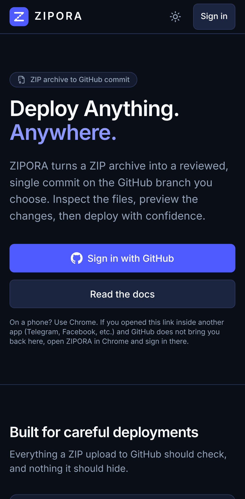
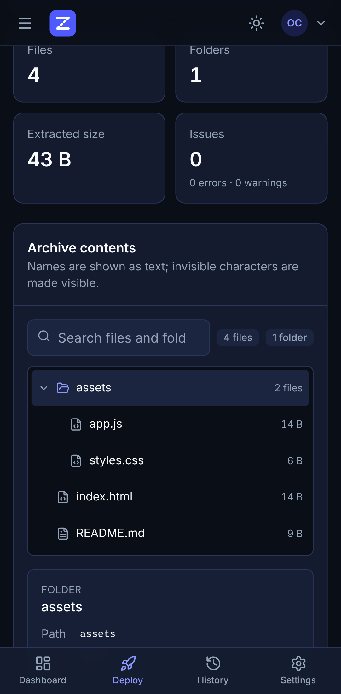
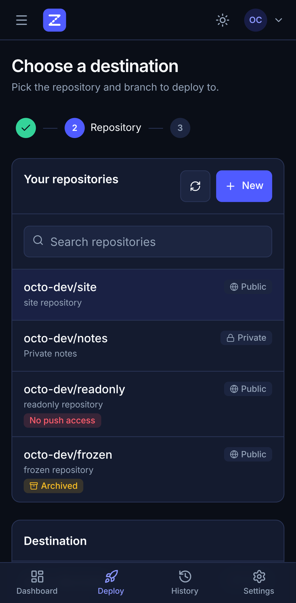
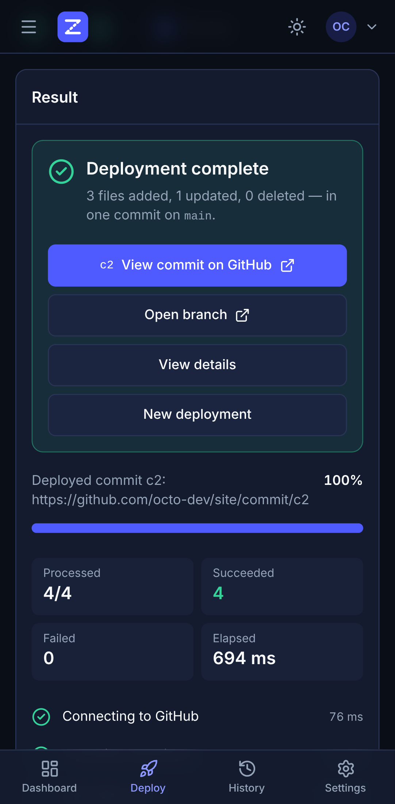
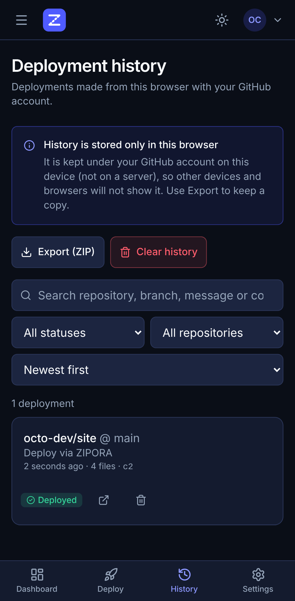
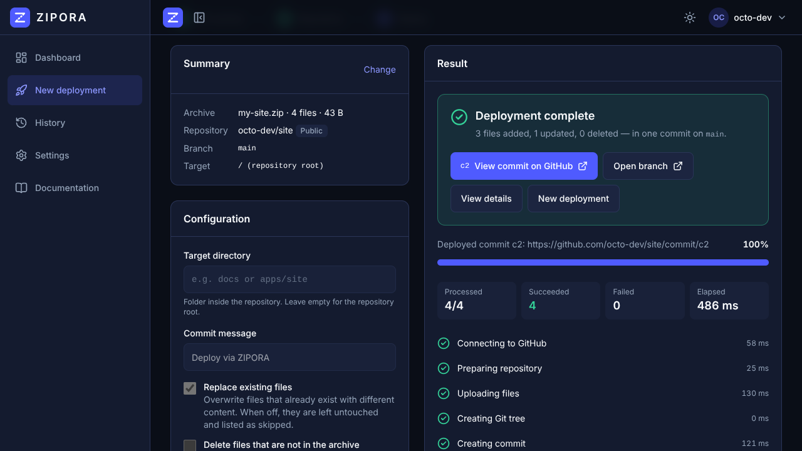

<div align="center">


### Deploy Anything. Anywhere.

Turn a ZIP archive into **one reviewed commit** on the GitHub branch you choose — from a phone or a computer.

</div>

---

## What is ZIPORA?

ZIPORA is a web app for developers who keep their projects as ZIP files and want them on GitHub without a terminal. Sign in with
GitHub, drop in a ZIP, review every file, pick a repository and branch, **preview exactly what will change**, and deploy. Files are
uploaded as Git blobs and trees and land as a **single commit**; if anything goes wrong before that commit, your branch is untouched.

It is built **Android-first**: large touch targets, a thumb-reach bottom navigation, a native file picker that reads from Files,
Downloads and Drive, mobile-friendly logs, and a setup you can complete entirely in a phone browser.

## Features

- **GitHub OAuth sign-in**, encrypted HttpOnly session cookies, CSRF protection, token never visible to page scripts
- **ZIP verification in the browser**: integrity (CRC), path-traversal / absolute path / `.git` / symlink rejection, duplicate and case-colliding paths, zip-bomb guard, size and file-count limits
- **File explorer**: nested folders, search, file-type icons, sizes, selected-file details and text preview, keyboard navigation, safe rendering of hostile file names
- **Repository & branch selection** with real GitHub data: search, public/private/archived/no-access badges, **create repository**, **create branch**, protected-branch warnings
- **Preview changes** (dry run against the live branch): new / changed / unchanged / deleted / skipped
- **Atomic deployment** with the Git Data API: parallel uploads under a memory budget, one commit, fast-forward-only branch update, automatic retry and one-time rebase if the branch moves, safe cancel until the commit starts
- **Live progress**: stages with real per-stage timings, counters, success/failure indicators, expandable logs, **copy or download logs**
- **History** (per GitHub account, in your browser): search, filter by status/repository, sort, commit and repository links, details, delete one or all, **export as ZIP**
- **Settings**: dark / light / system theme, deployment defaults, sign-out (revokes the token), clear-on-sign-out
- **Documentation** built into the app, including an error reference generated from the code
- **Accessibility**: automated WCAG 2.1 A/AA scans (axe-core) pass on every page in both themes; focus-trapped drawer; reduced-motion respected

## Screenshots

Captured from the real UI in real Chromium. **They show a mocked GitHub** (fake repositories and commit ids), not a real deployment.

| Landing | Upload | Repository | Result | History |
|---|---|---|---|---|
|  |  |  |  |  |



More in [`docs/screenshots/`](docs/screenshots) (desktop and mobile). Regenerate with `SCREENSHOTS=1 npm run e2e -- screenshots`.

## Technology stack

React 19 · TypeScript (strict) · Vite 8 · Tailwind CSS 4 · React Router 7 · Lucide icons · JSZip · Vercel Serverless Functions ·
GitHub OAuth + REST (Git Data API) · Vitest + Testing Library · Playwright + axe-core

## How it works

```
Browser (React SPA)                Vercel                                   GitHub
───────────────────                ──────                                   ──────
ZIP checked locally (JSZip)
Sign in ─────────────────────────► /api/auth/login   (state + PKCE) ──────► OAuth authorize
                                   /api/auth/callback (code → token) ◄───── token
                ◄── encrypted HttpOnly cookie
Deploy ──► /api/github/*  (session + CSRF + allow-list; token added HERE) ─► REST: blobs → trees → commit → ref
```

The GitHub token lives only in an encrypted cookie and is attached on the server. The browser talks to `/api/github/*`, a narrow
allow-listed proxy; it never sees the token.

## Quick start (local)

Requirements: Node.js 20+.

```bash
git clone <your-repo-url> zipora && cd zipora
cp .env.example .env        # fill in the values (see "GitHub OAuth configuration")
npm install
npm run dev                 # http://localhost:5173 — SPA and the real /api routes
```

Other commands: `npm test` (unit + UI), `npm run build` (type-check + production build), `npm run e2e` (Playwright, mocked GitHub).

## GitHub OAuth configuration

1. GitHub → **Settings → Developer settings → OAuth Apps → New OAuth App**.
2. **Homepage URL**: your app URL (e.g. `https://your-project.vercel.app`).
3. **Authorization callback URL**: your app URL + `/api/auth/callback` — exactly, e.g. `https://your-project.vercel.app/api/auth/callback`.
   GitHub allows one callback per OAuth App, so create a **second OAuth App for local development** with `http://localhost:5173/api/auth/callback`.
4. Create the app, then **Generate a new client secret**. Copy the Client ID and the secret.
5. Put them in the environment variables below.

Permissions: ZIPORA requests the `repo` scope by default (GitHub requires it to write to private repositories). Set
`GITHUB_OAUTH_SCOPE=public_repo` to restrict it to public repositories, or `none` when using a GitHub App.
Organization repositories may need an owner to approve the app (organization → Settings → Third-party access).

## Environment variables

| Variable | Required | Description |
|---|---|---|
| `GITHUB_CLIENT_ID` | yes | OAuth App client id |
| `GITHUB_CLIENT_SECRET` | yes | OAuth App client secret (server only) |
| `APP_URL` | yes | Public origin, no path (`https://…`; `http://localhost:5173` allowed for dev). Used for the OAuth redirect URI and origin checks |
| `SESSION_SECRET` | yes | ≥ 32 random characters. Encrypts session cookies |
| `SESSION_SECRET_PREVIOUS` | no | Old secret during rotation |
| `GITHUB_OAUTH_SCOPE` | no | Default `repo`; `public_repo`, or `none` for a GitHub App |
| `SESSION_TTL_SECONDS` | no | 300–2592000, default 604800 (7 days) |
| `PROXY_MAX_BODY_BYTES` | no | Default 4500000 (Vercel's request limit) |

**Never** give any of these a `VITE_` prefix: Vite would embed it in the public JavaScript. The build is scanned in tests to ensure
no secret names or Node crypto code appear in the browser bundle. Misconfiguration produces a clear `CONFIG_ERROR` that names the
missing variables (never their values).

## Deploying to Vercel

1. Put this project in a GitHub repository (see **Getting the code onto GitHub from a phone** below).
2. Vercel → **Add New → Project** → import the repository. The framework is detected as **Vite**; `vercel.json` already sets the build command, output directory (`dist`), the SPA rewrite, API function settings and security headers.
3. Add the four required environment variables (Settings → Environment Variables → Production). On the first deploy you only know your domain after it is created: deploy once (it will show a configuration error), copy the domain, create the OAuth App with it, add the variables, then **Redeploy**.
4. Open `https://<your-domain>` → **Sign in with GitHub**.
5. Run through [`docs/REAL_GITHUB_CHECKLIST.md`](docs/REAL_GITHUB_CHECKLIST.md) once with a throw-away repository.

Notes: OAuth callbacks only match the exact production URL, so sign in on the production domain, not on per-branch preview URLs.
`vercel.json` serves a strict Content-Security-Policy, HSTS, `X-Frame-Options: DENY` and a locked-down Permissions-Policy, and caches
hashed assets immutably while keeping `/api/*` uncached.

### Getting the code onto GitHub from a phone

This is the one awkward step without a computer, because GitHub's web uploader neither unzips archives nor preserves folders.
Options (**I have not tested these on a device**):

- **Termux** (Android terminal): `pkg install git unzip`, unzip the project, `git init`, add the remote, `git push` (use a GitHub personal access token as the password).
- **GitHub Codespaces** in Chrome (desktop site): upload the ZIP into the Codespace, `unzip` in its terminal, commit and push.
- **Bootstrap with another ZIP-to-GitHub tool once**; after ZIPORA itself is deployed, use ZIPORA to deploy updates to ZIPORA.

After that first push, everything (Vercel, OAuth App, environment variables, day-to-day deployments) works from a phone browser.

## Android notes

- Use **Chrome**. If you open a ZIPORA link inside another app's built-in browser (Telegram, Facebook…) and GitHub does not return you, open the link in Chrome.
- The ZIP picker accepts the MIME types Android reports for ZIP files (`application/zip`, `application/x-zip-compressed`, `application/octet-stream`). Pick from Files, Downloads or Drive.
- Logs and the history export are saved with the normal Android download flow (Downloads folder / download notification).
- The GitHub mobile app may offer to handle the authorization link; if sign-in stalls, open it in Chrome instead. *(Not verified on a device.)*

## Testing

| Command | What it runs | Against |
|---|---|---|
| `npm test` | Vitest: engine, server, UI components and full-app flows (**261 tests**) | In-process server + **fake GitHub** (jsdom) |
| `npm run e2e` | Playwright on a production build: desktop Chrome and an Android Pixel 7 profile (**64 test runs**: 29 on desktop Chrome + 35 on the Android profile), including axe-core accessibility scans, layout/overflow and touch-target audits, downloads | Real Chromium + real server code + **mock GitHub** |
| [`docs/REAL_GITHUB_CHECKLIST.md`](docs/REAL_GITHUB_CHECKLIST.md) | Manual end-to-end check | **Real GitHub** |

**Automated tests never contact GitHub.** The E2E suite fails if any request leaves `localhost`. A passing suite shows ZIPORA behaves
correctly against a faithful fake — it does **not** prove GitHub accepts every request; use the checklist for that.
`npm run e2e` uses Playwright's Chromium (`npx playwright install chromium`); where that download is blocked it falls back to the
Chromium inside `@sparticuz/chromium`.

## Security notes

- OAuth with `state` and PKCE; the state cookie is single-use and expires in 10 minutes; the post-login redirect only accepts same-site paths.
- Session cookie: AES-256-GCM sealed, `HttpOnly`, `Secure`, `SameSite=Lax`, `__Host-` prefixed on https; key rotation supported.
- CSRF: `Sec-Fetch-Site` and `Origin` checks plus a per-session HMAC token on every state-changing request.
- The GitHub proxy only forwards the endpoints needed for deployment, strips client credentials and upstream cookies, and rewrites pagination links.
- ZIP content is never interpreted as HTML; file names are shown as text with invisible/bidi characters made visible; avatars load only from `avatars.githubusercontent.com`.
- Logs redact token-shaped strings; configuration errors never print secret values.
- Stateless sessions cannot be revoked server-side: sign-out revokes the GitHub token and clears the cookie, but a copied cookie stays valid until it expires unless its token is revoked. Rotating `SESSION_SECRET` ends all sessions.

## Known limitations

- **Not verified against real GitHub, a real Android device, or a live Vercel deployment** by the author of these tests — see the checklist and the notes above.
- Through the serverless proxy a **single file above ≈ 3.2 MB cannot be uploaded** (Vercel's ~4.5 MB request cap); such files are rejected before upload. Very large repository trees may not fit the ~4.5 MB response cap either.
- Archive limits: 100 MB, 5,000 files, 500 MB extracted. The whole archive is held in memory; a low-memory phone may struggle near the limit. ZIP64 and encrypted archives are unsupported.
- History and preferences live in the browser (not on a server): clearing site data or switching device starts fresh. Export keeps a copy.
- Repository search is client-side over the 500 most recently updated repositories.
- Concurrent token refresh across multiple serverless instances can race (GitHub App expiring-token mode only).
- Tested in Chromium only (not Firefox/Safari). No automated test on a physical device.

## Project structure

```
api/            Vercel Functions (thin entry points)
src/engine/     ZIP verification + GitHub Git Data deployment engine
src/server/     OAuth, sessions, CSRF, GitHub proxy
src/client/     AuthClient (browser side)
src/components, pages, layouts, hooks, contexts, services, utils, types, styles/   the React app
tests/          Vitest suites · tests/e2e Playwright (mocked GitHub)
scripts/        E2E server (mock GitHub), runners
docs/           Screenshots, brand assets, real-GitHub checklist
```

## License

[MIT](LICENSE). Third-party software (direct dependencies): React, React DOM, React Router, Vite, Vitest, Testing Library, Tailwind CSS,
`@vitejs/plugin-react`, jsdom, TypeScript, `@types/*` — MIT or Apache-2.0; Lucide — ISC; **JSZip — dual-licensed (MIT OR GPL-3.0-or-later), used under MIT**;
Playwright — Apache-2.0; `@axe-core/playwright` — MPL-2.0; `@sparticuz/chromium` — MIT (it packages a Chromium build, which carries its own licenses).
Development-only tools are not shipped in the production bundle.
